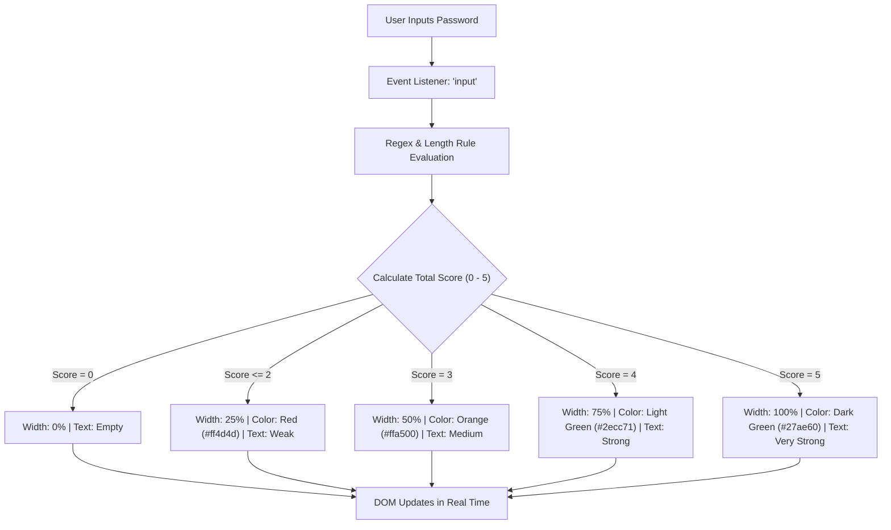

# Project Documentation: Password Strength Checker

---

## 📌 Project Overview
**Password Strength Checker** is an interactive, responsive front-end web application that evaluates password complexity in real time as the user types. It provides instant visual feedback via a dynamic multi-stage color progress bar and clear descriptive status indicators, helping users create secure credentials.

- **GitHub Repository**: [harishravi0702-lgtm/password-strength-checker](https://github.com/harishravi0702-lgtm/password-strength-checker)
- **Primary Branch**: `main`
- **Application Type**: Client-Side Single-Page Web Application (SPA)
- **Tech Stack**: HTML5, CSS3, Vanilla JavaScript (ES6+)

---

## 🚀 Key Features
- **Real-Time Input Validation**: Evaluates password strength on every keystroke (`input` event listener) without requiring page reloads or form submissions.
- **Dynamic Multi-Level Strength Bar**: Visually transitions between four stages (Weak, Medium, Strong, Very Strong) using CSS animations.
- **Comprehensive Security Criteria**: Checks for minimum character length, uppercase characters, lowercase characters, numeric digits, and special symbols.
- **Clean Responsive Interface**: Centered card layout with modern drop shadows, rounded corners, and clear typographic hierarchy.
- **Zero External Dependencies**: Pure native web technologies without external frameworks or heavy libraries.

---

## 🏗️ Architecture & Component Workflow



---

## 📁 Repository & File Structure

```
password-strength-checker/
├── index.html              # Core HTML structure, markup, and requirements list
├── style.css               # Styling, layout, and progress bar transitions
├── script.js               # Event handling, regex validation, and score calculation
├── README.md               # Quick-start guide and repository summary
└── PROJECT_DOCUMENTATION.md # Detailed technical specifications and documentation
```

### File Details
1. **[index.html](index.html)**:
   - Houses the `<input type="password">` field.
   - Contains the container for the strength bar (`.strength-bar` and `#strength`).
   - Displays real-time evaluation text (`#strengthText`) and security guidelines (`.requirements`).
2. **[style.css](style.css)**:
   - Implements a modern flexbox container centered on the viewport.
   - Sets smooth CSS transitions (`transition: 0.3s`) for fluid bar width adjustments.
3. **[script.js](script.js)**:
   - Attaches an `input` listener to `#password`.
   - Executes Regex validations and modifies DOM styles dynamically.

---

## 🔐 Strength Scoring Algorithm

Each entered password begins with a base score of `0` and gains `+1` point for each satisfied security criterion:

| Criterion | Regular Expression / Condition | Points Awarded |
| :--- | :--- | :---: |
| **Minimum Length** | `password.length >= 8` | +1 |
| **Uppercase Letter** | `/[A-Z]/` | +1 |
| **Lowercase Letter** | `/[a-z]/` | +1 |
| **Numeric Digit** | `/[0-9]/` | +1 |
| **Special Character** | `/[@$!%*?&]/` | +1 |

### Strength Levels & UI Mapping

| Total Score | Level | Bar Width | Bar Color | Hex Code |
| :---: | :--- | :---: | :--- | :---: |
| `0` | Empty / Initial | 0% | Transparent | - |
| `1 – 2` | **Weak** | 25% | Red | `#ff4d4d` |
| `3` | **Medium** | 50% | Orange | `#ffa500` |
| `4` | **Strong** | 75% | Light Green | `#2ecc71` |
| `5` | **Very Strong** | 100% | Dark Green | `#27ae60` |

---

## 💻 How to Run Locally

### Option 1: Direct File Opening
Double-click `index.html` or right-click and select **Open with > Any Web Browser**.

### Option 2: Local HTTP Server (Python)
Run the following in PowerShell:
```powershell
cd "c:\Users\LN SAHANA\OneDrive\ドキュメント\Password Strength Checker"
python -m http.server 5500
```
Then open `http://localhost:5500` in your web browser.

---

## 🔗 Quick Links
- **GitHub Repository**: [https://github.com/harishravi0702-lgtm/password-strength-checker](https://github.com/harishravi0702-lgtm/password-strength-checker)
